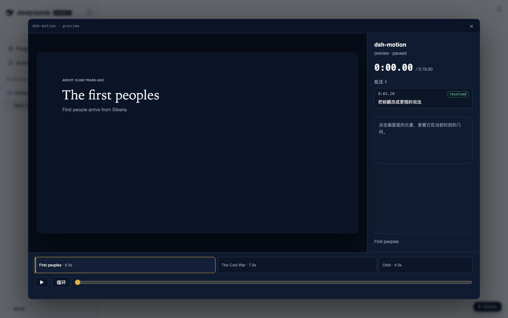

# dsh-motion

Motion 渲染内核的最小实现：**timeline + 文本槽 + 调色板 → 逐帧捕获 → MP4**。
这是 [motion-kernel-contract.md](../motion-kernel-contract.md) 的可运行版本，用来验证三个接口，不是插件。

## 跑起来

```bash
npm install          # 只装 playwright（浏览器用本机缓存的 Chrome for Testing）
npm run gates        # 画面门禁，14 项断言（含 WebGL 确定性）
npm run audio        # 合成音床 + 节拍分析 + 波形图
npm run video        # 15 秒片子（含音频）→ out/demo.mp4
npm run gate:audio   # 音频门禁，8 项断言
npm run gate:ui      # 预览界面门禁，11 项断言
npm run gate:comments # 批注回路门禁，13 项断言
npm run preview      # 本地预览 → http://127.0.0.1:4173/preview.html
```

当前实测（2026-10-19，本机 M 系列 / node 22 / ffmpeg 8.1.2）：

| 项 | 结果 |
|---|---|
| 画面门禁 | **14/14 通过**（含 WebGL） |
| 音频门禁 | **8/8 通过** |
| 视频 | 1920×1080 / 30fps / 19.0s / H.264 + AAC 48k / 3.1 MB |
| 响度 | **−14.1 LUFS**（目标 −14） |
| 节拍 | 检出 **119 BPM**（真值 120）、29 拍、drop **7.98s**（真值 8.0） |
| 捕获速度 | 570 帧 **约 11 秒**（含 WebGL 段） |
| 拼图 | 8 帧 4 列 → `out/sheet.png`｜波形 → `out/wave.png` |
| 界面门禁 | **11/11**（场景条 / 播放头 / 选中 / 播放） |
| 批注门禁 | **13/13**（框选 → 批注 → 工具 → 改字 → 回复 → 解决） |

## 三个接口

1. **`render(t)`**：场景只导出 `mount(ctx)` / `render(t)`，`t` 为秒；禁 `Math.random` / `Date.now` / `rAF`，随机走 `ctx.rng(key)`。
2. **文本槽**：场景声明 `slots` + `textUsage`，代码只读 `ctx.text('title')`；写走 `setText()`，下一帧生效，不重编译。
3. **调色板**：代码只读 `ctx.color('accent')`；解析链 `元素覆盖 → 场景覆盖 → 场景调色板 → main → 抛错`，不静默回退黑色。

另外两条为 3D 增加的约定：

- **场景各有自己的 canvas**：canvas 只能持一种 context，所以 2D 与 WebGL 场景各画各的，内核再 `drawImage` 合成到显示画布。
- **可选 `overlay(g, ctx, t)`**：合成之后在显示画布上画 2D 图层，3D 场景因此能复用同一套文本槽与排版。

## 目录

```
timeline.json              时间源：scenes[] / palettes{} / texts{}
index.html                 画布页
src/kernel.mjs             时间轴、挂载、解析、渲染
src/palette.mjs            颜色解析（缺 token 抛错）
src/texts.mjs              槽读写 + 使用计数校验
src/rng.mjs                确定性随机
src/scenes/history.mjs     时间轴式场景的共享画法（双泳道卡片 + 节拍脉冲）
scripts/serve.mjs          开发用静态服务器（file:// 不能加载 ES module）
scripts/capture.mjs        still / sheet / video（有音轨时自动 mux）
scripts/gates.mjs          画面门禁（确定性 / 文本槽 / 调色板）
scripts/synth.mjs          确定性音床（纯合成，无版权素材）
scripts/beats.mjs          节拍分析：BPM / 拍点 / drop
scripts/wave.mjs           波形 + 拍线 + drop 标记 → 给 agent 看
scripts/mux.mjs            silent.mp4 + 音频 → 成片（视频流直接 copy）
scripts/gate-audio.mjs     音频门禁（流 / 时长 / 响度 / 节拍）
```

## 门禁抓到的两个真问题

1. **macOS 的颜色管理**：canvas 默认按 display-P3 读回，`#0b1426` 取出来是 `15,26,45`。修法是建 context 时钉 `colorSpace: 'srgb'`，且必须在任何场景取 context 之前。
2. **采样点落在网格线上**：门禁第 2 项一度"背景变了"，实际是采样点 `(12,12)` 正好压在一根竖网格线上。换成网格外坐标后恢复。

## 3D 段

`src/scenes/orbit.mjs`：three.js 0.186 的环面纽结 + 五个轨道球 + 网格，镜头绕行，按拍脉冲缩放；
文字由 `overlay` 画在合成层上，左侧加了一层渐变遮罩保证可读性。

G4 证明 **WebGL 在逐帧捕获下也满足「同一个 t 两次渲染字节级相同」**——这是 3D 能走同一条管线的前提。

## 预览界面

```bash
npm run preview   # http://127.0.0.1:4173/preview.html
```

播放 / 暂停、拖播放头、点场景条跳转、点画面里的元素看它的几何（只读检视器）。


检视器里的 `x / y`、`w × h` 与场景实际绘制用的是**同一份布局函数**，不是估出来的。

## 批注回路

在暂停帧上拖出一个框 → 写一句 → `Send to Claude`，批注以三要素锚定入库：

```jsonc
{ "anchor": { "t": 3.2, "rect": {"x":150,"y":235,"w":570,"h":100}, "elementId": "pin-…" },
  "text": "把标题改成更短的说法", "activated": true, "status": "open" }
```


工具契约（当前是 CLI，插件里会变成 `motion_comments`）：

```bash
node scripts/comments.mjs list --json --crops   # 列出线程，并为每个线程生成裁剪图
node scripts/comments.mjs reply --id th_x --text "改好了"
node scripts/comments.mjs resolve --id th_x
```

`--crops` 会按锚点打开对应时刻，把 `rect` 外扩 20% 截一张图（`out/comments/<id>.png`）——模型看图比读坐标准。

改文本走 `node scripts/texts.mjs set --scene … --slot … --value …`：写 `timeline.json` → 校验 → 下一帧生效，**不重编译**。

## 作为 dsh 插件

```bash
npm run build:client                      # 打包面板（three 内联，约 1.1 MiB）
dsh plugin --profile web add <repo 路径>   # 本地目录安装（先 npm run link 供 SDK）
```

- **工具**：`motion_info`、`motion_texts`、`motion_palette`、`motion_comments`、`motion_render`、`motion_export`
- **面板**：右下角 `◐ Motion` → iframe 打开 `/plugins/dsh-motion/app`，内容与 standalone 预览同源



`npm run gate:plugin` 验证安装与启动；`npm run gate:client` 在真实 dsh web 里验证面板路由、
场景条跳转、启动器挂载与 iframe 可用；`npm run gate:tools` 用真实会话调一次工具，并跑一次
“写错 inject”的负控（需要本机凭据，缺失时跳过）。


## 能力面

| 工具 | 说明 |
|---|---|
| `motion_info` | 时间轴、场景、调色板、节拍摘要 |
| `motion_texts` | 读写文本槽（写前校验，非法拒绝） |
| `motion_palette` | 改共享 token 或元素级 override |
| `motion_comments` | 列出 / 回复 / 解决批注线程（带三要素锚点） |
| `motion_render` | 接触表（stills）或 MP4（video） |
| `motion_export` | 导出 `mp4` 或 `gif`（GIF 从成片转码，无音频） |

| 界面 | 说明 |
|---|---|
| `◐ Motion` 启动器 | 右下角浮层，打开面板 |
| 面板 | 播放器 / 场景条 / 元素检视 / 批注浮层（iframe 同源预览） |

## 吸收自 huashu-art-motion 的两个门禁

来源：[alchaincyf/huashu-art-motion](https://github.com/alchaincyf/huashu-art-motion)（MIT）。
只吸收**规则与阈值**，实现独立编写。

### `npm run gate:film`（读成片，不读代码）

三条失败模式，ffmpeg 解码即可算：

| 指标 | 红 | 黄 |
|---|---|---|
| 快速运动帧占比（12fps，相邻帧平均灰度差 ≥9） | < 0.035 | < 0.06 |
| 中段近乎纯色的空画面（边缘像素占比 <0.2%） | 连续 ≥0.3s | — |
| 蓝紫底画面占比（色相 225–300°，饱和 ≥0.3） | ≥ 0.30 | ≥ 0.12 |

阈值来自其 `film_gate.py`（2026-10 用 13 支人评片标定），**换内容域要重标定**；
可用 `--min-motion` / `--max-purple` 覆盖。

本仓库示例片实测：**fast-motion 0.004 → 红灯**，空画面 0，蓝紫 0%。
这不是门禁坏了，是示例片确实偏静态（逐帧只有一个慢淡入和几处卡片入场）——它低于艺术动画的标定线。
企业讲解片是否该用同一阈值，需要自己的标定集。

### `npm run gate:layout`（版面审计）

渲染每个采样帧，记录每次 `fillText` 的位置/字号/透明度，然后检查：

- 文字是否在安全区内（边距 60px）
- 字号是否 ≥14px（缩到手机宽度仍可读）
- 同一帧的文字框是否互相重叠

当前示例片：**384 个文本框、38 帧，零违规**。

## 兼容性

| dsh 版本 | 状态 |
|---|---|
| `0.2.1-rc.1` | ✅ 已验证（2026-10-19）：安装、启动、面板、工具调用、负控 |
| 其它版本 | ⚠️ 未验证——插件机制面（服务名 / 槽名 / manifest 字段）跨 rc 会改名；升级后若启动日志出现 `entry did not activate`，先核对 `webServer` 与 `tools` 两个服务名 |

## 插件管理

装/卸/启停用官方 CLI：`dsh plugin --profile web add|remove <包>`；已装插件在**侧边栏 Plugins 页**
里查看与配置。卸载不会自动删除 `out/comments.json` 等运行数据，需要时手动清理。

## 已知限制

- 只有一条音轨，没有旁白轨与 ducking
- 音频 fit 只实现 `trim`（loop / pad 未实现）

- 没有 UI（预览/场景条/批注面板）
- client half 尚未接入（Node 工具已可用）
- 没有打包成单文件 HTML（开发用静态服务器）
- 字体只用系统族，未入库
- WebGL 确定性只在本机（Apple GPU + Chrome for Testing）验证过；换机器/驱动需重跑 G4
