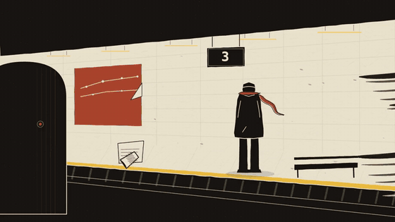
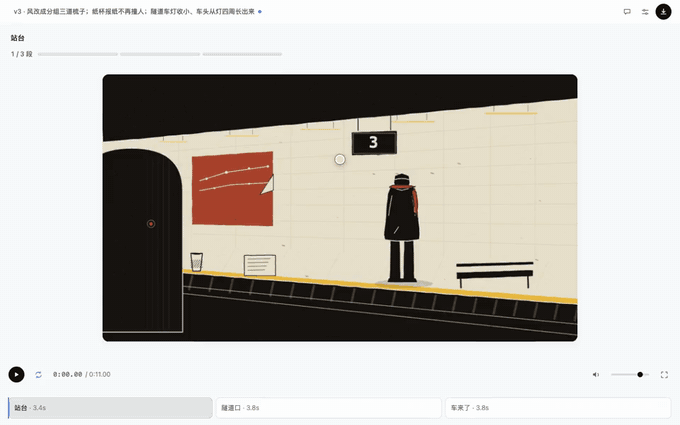

<h1 align="center">dsh-motion</h1>

<p align="center">
  <a href="https://github.com/vlln/dsh-motion/stargazers"></a>
  <a href="#兼容性"></a>
  <a href="https://nodejs.org/"></a>
  <a href="LICENSE"></a>
</p>

<p align="center"><strong>和 Agent 一起做动画，留下的不只是视频，还有能继续修改的代码。</strong></p>
<p align="center">描述想法 → 确认分镜 → 预览与批注 → 导出 MP4</p>

<p align="center">
  
</p>
<p align="center"><sub>示例作品「地铁进站时的一阵风」 · 11 秒 · <a href="docs/demo/platform.mp4">观看带声音的完整版</a></sub></p>

**dsh-motion 是 [DeepSeek Harness](https://github.com/deepseek-ai/deepseek-harness) 的动画制作插件。** Agent 在你的工作区里编写场景、组织时间轴并渲染视频；你在对话旁边预览，直接调整文字和参数，或框出画面告诉它哪里需要改。

它适合片头、产品讲解、数据动画和风格化短片，尤其适合需要反复修改文案、数字、节奏的作品。**它不是文生视频模型，也不是完整的非线性剪辑软件**：画面由场景代码与素材合成，创作质量仍取决于分镜、素材和 Agent 的实现。

## 为什么把动画写成代码

“标题再短一点”“这个数字换掉”“结尾多停一秒”——这些修改不应该意味着重新生成整条视频。

dsh-motion 把场景、文字、颜色和时间轴保存在工作区中。你可以让 Agent 精确修改其中一处，也可以自己在面板里调。作品能用 Git 管理，重要修改可以保存为命名版本，再切回比较。

- **可控**：文字与数字来自明确的数据，不依赖视频模型生成字形。
- **可修改**：场景可以把文字、数值、颜色和参数暴露给面板，不必每次都让 Agent 改代码。
- **不绑定模板**：引擎负责渲染与导出，画法由场景决定；随附的样例可以修改或删除。

## 安装

### 1. 准备运行环境

| 依赖 | 用途 |
|---|---|
| Node.js 22 或更高版本 | 运行插件和命令行 |
| dsh web | 提供对话、Agent 和预览侧栏；仅用 CLI 时不需要 |
| Chromium / Chrome for Testing | 预览检查与逐帧渲染，由 Playwright 驱动 |
| FFmpeg（含 `ffprobe`） | 视频编码、音频处理与成片检查；需在 `PATH` 中 |

这些依赖需要装在**运行 dsh 的机器**上，而不只是打开 GUI 的电脑上。浏览器不会由插件自动下载。已有浏览器可以通过 `CHROMIUM` 指定**可执行文件的绝对路径**，并让启动 dsh 的进程继承这个变量；未指定时会尝试本机 Playwright 浏览器缓存及其默认浏览器。

```bash
# macOS 示例：已安装 Homebrew 时
brew install ffmpeg

# 如未安装可供 Playwright 使用的 Chromium
npx playwright@1.64.1 install chromium
```

### 2. 安装插件

在 dsh 的 **Plugins → 添加插件** 中输入：

```text
@vlln/dsh-motion
```

或使用 CLI：

```bash
dsh plugin --profile web add @vlln/dsh-motion
```

安装后，在会话的**右侧栏**选择 **动画**。若没有出现，先刷新页面；仍未出现时重启 dsh，并到 Plugins 页确认插件已启用。

> 想跟最新提交而不是发布版：`dsh plugin --profile web add github:vlln/dsh-motion`。插件会向 Agent 注册 `dsh-motion` skill，并把命令加入 dsh 进程的 `PATH`；这不等于在你的外部终端全局安装了命令。

## 做第一条动画

在你准备存放作品的工作区开启会话，向 Agent 描述主题、时长和画幅。例如：

> 用 dsh-motion 做一条 12 秒、16:9 的产品片头。主题是“把杂乱的笔记整理成清晰的想法”，暖白底、墨黑字，少量橙色强调。先给我看分镜，确认后再制作。完成后导出带声音的 MP4，并保存一个版本。

制作分成四步：

1. **确认分镜**：Agent 先写清每一镜里有什么、它在做什么，以及整体画风。
2. **看粗版**：先看静帧和运动，再决定细节；初始化本身不会生成成片。
3. **边看边改**：在右侧「动画」中预览，直接调已开放的字段，或通过批注让 Agent 修改。
4. **导出与保存**：生成 MP4，检查成片，再保存带说明的版本。检查通过之后仍要实际观看。

插件提供的 [dsh-motion skill](<skills/dsh-motion/SKILL.md>) 负责指导这套制作流程。**没有额外的 `motion_*` 工具需要学习**，Agent 使用文件编辑和命令行完成制作。

## 预览、修改、再导出

<p align="center">
  
</p>

| 你想做什么 | 怎么操作 |
|---|---|
| 看某一镜或某一帧 | 播放、暂停、拖动播放头，或点击场景条定位 |
| 改标题、数字或配色 | 在面板编辑场景开放的文字槽、数值槽与调色板 |
| 微调位置、大小等效果 | 调整场景声明的数值参数；可调项由场景作者决定 |
| 告诉 Agent 哪儿不对 | 暂停后框选区域并发送批注，意见进入当前会话，画面保留定位标记 |
| 找回之前的版本 | 制作时让 Agent 保存命名版本，在面板版本列表中切换 |
| 拿到成品 | 让 Agent 用命令行导出 MP4、GIF 或静帧，返回产物路径 |

改时间轴数据可更新预览；**改场景代码后需要刷新面板**。面板不是自由拖拽的场景编辑器：新增镜头、改变构图或实现新画法，仍交给 Agent 修改代码。

## 命令行用法

不使用 dsh 面板，也可以把它作为本地渲染工具安装：

```bash
npm install -g @vlln/dsh-motion
mkdir my-film && cd my-film
dsh-motion init --title "我的第一条动画"
```

`init` 只创建空时间轴、镜头表和样例工具库。**接下来需要你或 Agent 编写场景、把它排进时间轴，并准备音轨**；完整写法见 [制作手册](<skills/dsh-motion/SKILL.md>)。完成这些之后，再运行：

```bash
# 所有命令都在 my-film 工作区根目录执行，不要进入 motion/ 再跑
dsh-motion check
dsh-motion render --stills 0,3,6 --out out/sheet.png
dsh-motion render --video --out out/film.mp4
dsh-motion check --deliver --file motion/out/film.mp4
dsh-motion version -m "第一版：完成分镜、动画和声音"
```

`render --out` 相对于作品目录 `motion/`；`check --deliver --file` 接收相对于当前目录的文件路径。不指定 `--file` 时，检查作品输出目录里最近修改的 MP4。

<details>
<summary>参考视频、GIF 与版本命令</summary>

```bash
# 从本地参考视频提取帧与切点，辅助设计分镜
dsh-motion reference reference.mp4

# 导出 GIF（没有声音）
dsh-motion render --export --gif --out out/film.gif

# 列出版本，或切回指定版本
dsh-motion version list
dsh-motion version use v1
```

参考分析不等于自动复刻：构图、动作和缓动仍需要编写。

</details>

## 使用前需要知道

- **一工作区一部作品**。面板读取当前会话工作区的作品，不会自动拿插件的示例片代替。
- **导出是逐帧渲染**，不是实时录屏；复杂场景和长片会更慢，大段视频素材也可能占用较多内存。
- **音频不是多轨剪辑台**。最终使用一条音轨，不提供完整的旁白轨、混音台与自动 ducking。
- **新建作品建议用 CLI 导出**。面板导出与素材重烘焙目前存在项目内脚本路径问题，尚不能保证新工作区开箱可用。
- **MP4 不支持透明背景**。GIF 没有声音。
- **可复现有环境边界**。确定性场景在相同环境下可重复渲染；不同系统字体、浏览器和 GPU 可能带来差异，不承诺跨机器逐像素一致。
- **交付检查不是审美评分**。它检查音视频流、时长、空画面、运动等，并包含蓝紫色占比规则；有意使用该配色时可传 `--allow-blue-purple "理由"`。构图、风格与叙事仍需人工审片。

## 安全与数据

- 作品、素材、导出结果和版本保存在会话工作区中；面板修改会写入作品数据，切换版本会恢复保存的内容。
- 渲染会启动本地浏览器与 FFmpeg，并执行场景 JavaScript。**不要把不可信的场景代码当作普通视频文件直接运行。**
- 本地渲染不需要视频生成 API；对话和批注仍走 dsh 配置的模型服务。若让 Agent 搜索素材或调用生图服务，会发生相应的网络请求，不能据此认为整个创作过程都离线。
- 使用外部图片、音乐与字体时，需要自行确认许可与署名要求。

## 兼容性

| 环境 | 状态 |
|---|---|
| dsh web `0.2.1-rc.1` | 已有验证记录（2026-10-27）：面板、参数、批注、版本切换和交付检查 |
| 其它 dsh 版本 | 未验证；若「动画」入口不出现，需核对宿主侧栏能力与插件加载状态 |
| 官方 Desktop | 未验证；web profile 的安装不代表已安装到 Desktop |
| 渲染平台 | 已有 macOS / Apple GPU + Chrome for Testing 的验证记录；其它平台未验证 |

## 插件管理

在侧边栏 **Plugins** 页查看插件状态、启用或停用插件。卸载使用：

```bash
dsh plugin --profile web remove @vlln/dsh-motion
```

作品存放在工作区，卸载插件不会替你清理作品。独立安装的全局 CLI 则使用 `npm uninstall -g @vlln/dsh-motion` 卸载。

## 文档与致谢

- [Agent 制作手册](<skills/dsh-motion/SKILL.md>)：场景编写、声音、参考分析与交付流程。
- [内核契约](<docs/kernel-contract.md>) · [设计决策](<docs/decisions.md>)：面向希望深入实现的开发者。
- **Claude Motion** 启发了这个项目的创作方向：让 Agent 直接参与制作会动的画面。
- **[huashu-art-motion](https://github.com/alchaincyf/huashu-art-motion)**（花叔 · 花生，MIT）提供了风格研究、图像与代码合成、媒介表现和空工作区展示等方面的参考。

## 许可

[MIT](<LICENSE>)。
