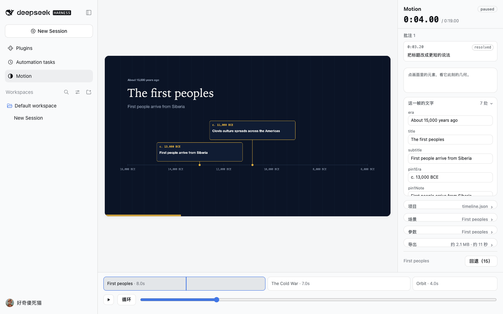
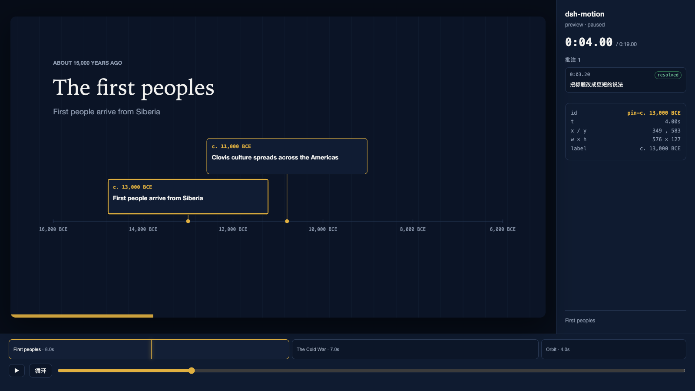
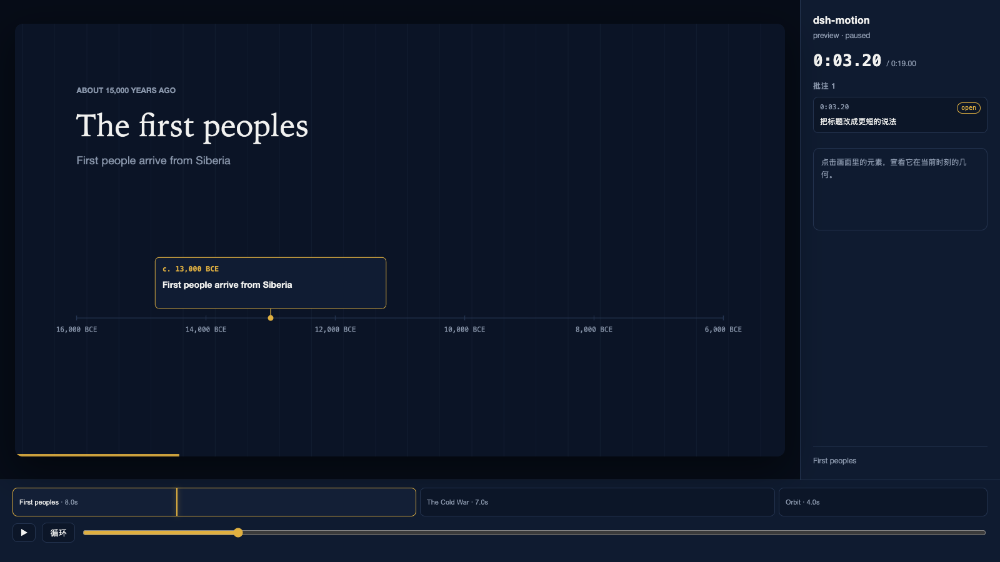
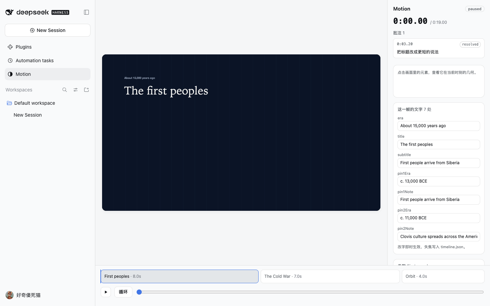
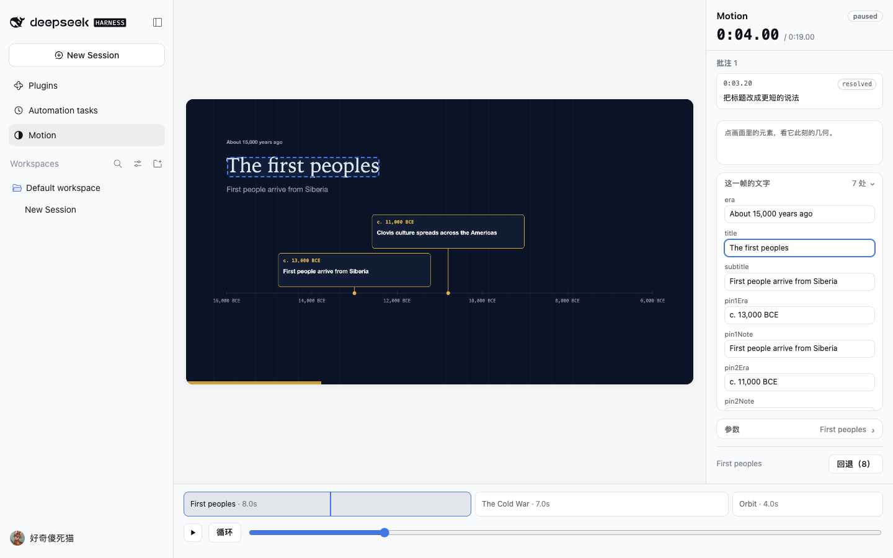
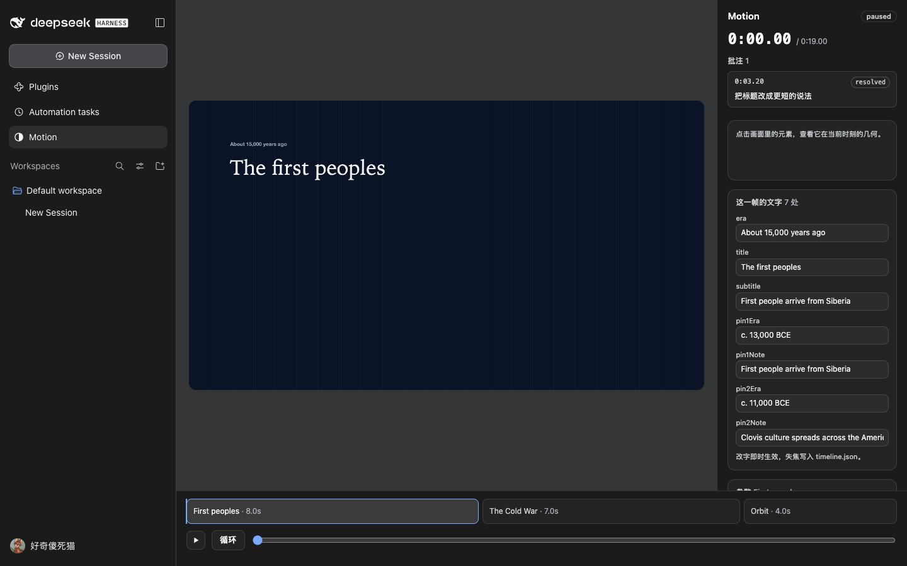
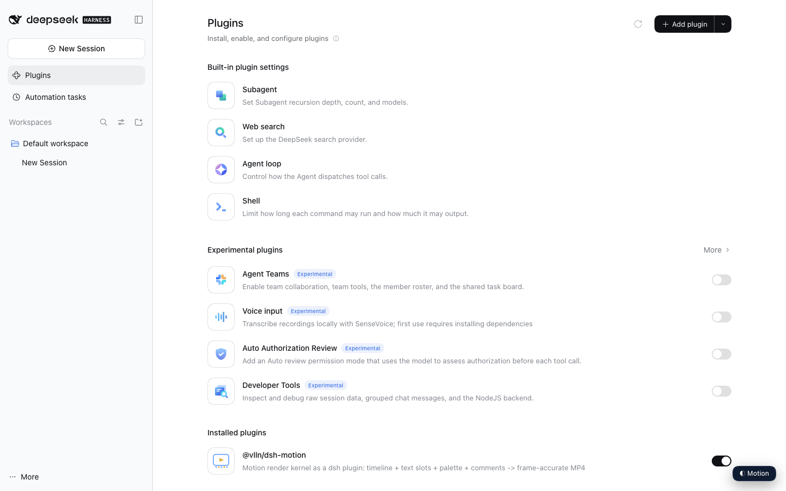
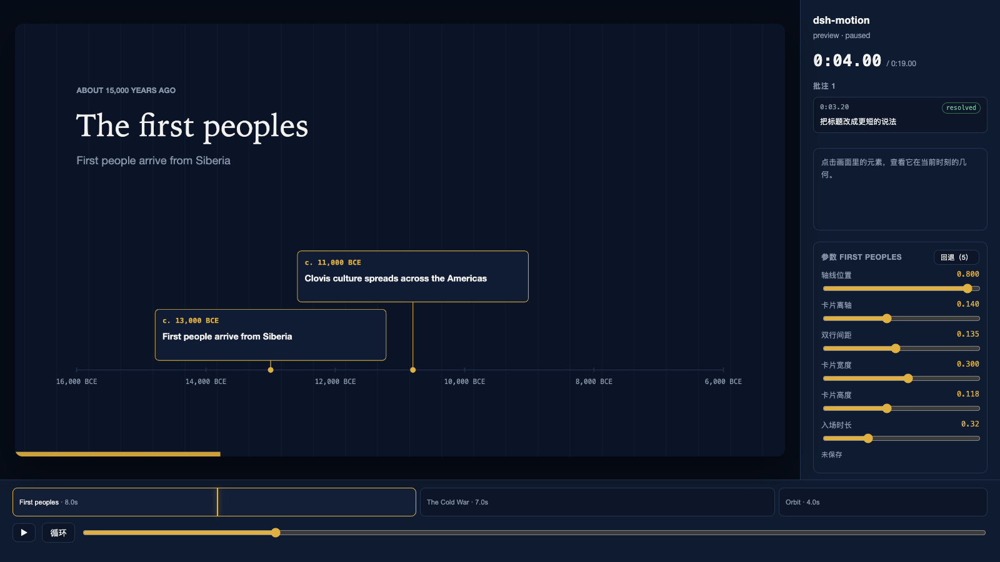

# dsh-motion

Motion 渲染内核的最小实现：**timeline + 文本槽 + 调色板 + 参数 → 逐帧捕获 → MP4**。
契约见 [docs/kernel-contract.md](docs/kernel-contract.md)，原语清单见 [docs/primitives.md](docs/primitives.md)，
技术栈的取舍与「什么会让我们改主意」见 [docs/decisions.md](docs/decisions.md)。

## 跑起来

```bash
npm install          # 只装 playwright（浏览器用本机缓存的 Chrome for Testing）
npm run gates        # 画面门禁，14 项断言（含 WebGL 确定性）
npm run audio        # 合成音床 + 节拍分析 + 波形图
npm run video        # 19 秒片子（含音频）→ out/demo.mp4
npm run gate:audio   # 音频门禁，8 项断言
npm run gate:ui      # 预览界面门禁，12 项断言
npm run gate:comments # 批注回路门禁，13 项断言
npm run gate:params  # 参数回路门禁，13 项断言（拖 → 写 → 回退，含负控）
npm run gate:surface # 工具面门禁，15 项断言（每个工具真跑一次）
npm run gate:reference # 参考摄取门禁，15 项断言（合成片 + 静态负控 + 确定性）
npm run gate:text     # 文字门禁，14 项断言（中文断行 / 命中 / 确定性）
npm run gate:media    # 媒体门禁，11 项断言（图片 / 片段雪碧图 / 缺素材负控）
npm run gate:tweaks   # 面板改字门禁，11 项断言（按帧列槽 / 点字聚焦 / 落盘 / 越界拒绝）
npm run gate:scale    # 缩放门禁，5 项断言（默认 60fps / 2× 超采样 / 钳制）
npm run gate:values   # 数据槽门禁，14 项断言（格式化 / 面板改数 / 图表变化 / 写盘）
npm run gate:assets   # 素材门禁，18 项断言（换图即时生效 / 片段重烘 / 路径守卫）
npm run gate:scene    # 场景门禁，7 项断言（改段长后重新排布 / 总时长 / 负控）
npm run gate:export   # 导出门禁，7 项断言（成片尺寸帧数 / 面板端点 / 负控）
npm run gate:project  # 项目门禁，10 项断言（模板建项目 / 校验 / 重名 / 文件服务）
npm run assets        # 把 timeline.assets 里的片段烘成雪碧图 → out/media/
npm run preview      # 本地预览 → http://127.0.0.1:4173/preview.html
```

当前实测（2026-10-19，本机 M 系列 / node 22 / ffmpeg 8.1.2）：

| 项 | 结果 |
|---|---|
| 画面门禁 | **14/14 通过**（含 WebGL） |
| 音频门禁 | **8/8 通过** |
| 视频 | 1920×1080 / **60fps** / 19.0s / H.264 + AAC 48k / 4.1 MB |
| 响度 | **−14.1 LUFS**（目标 −14） |
| 节拍 | 检出 **119 BPM**（真值 120）、29 拍、drop **7.98s**（真值 8.0） |
| 捕获速度 | 1140 帧 **约 23 秒**（60fps，含 WebGL、音频与封装）≈ 20ms/帧 |
| 拼图 | 8 帧 4 列 → `out/sheet.png`｜波形 → `out/wave.png` |
| 界面门禁 | **12/12**（场景条 / 播放头 / 选中 / 播放） |
| 批注门禁 | **13/13**（框选 → 批注 → 工具 → 改字 → 回复 → 解决） |
| 参数门禁 | **13/13**（拖动改画面 → 松手写文件 → 快照 → 重载 → 拒绝越界 → 回退） |
| 工具面门禁 | **15/15**（9 个工具全部注册并真跑一次只读路径） |
| 参考摄取门禁 | **15/15**（切点 / 配色 / 运动 / 静态负控 / 两次跑同字节） |
| 文字门禁 | **14/14**（中文断行 / 禁则 / 省略号 / 按槽命中 / 同帧两次一致） |
| 媒体门禁 | **11/11**（图片 / 片段随 t 推进 / 路径穿越拒绝 / 缺素材响亮报错） |
| 改字门禁 | **11/11**（按帧列槽 / 点字聚焦 / 输入即改 / 失焦落盘 / 快照 / 越界拒绝） |
| 缩放门禁 | **5/5**（默认 60fps / 2× 超采样保住细节 / 钳制到 2） |
| 数据槽门禁 | **14/14**（格式化 / 面板改数 / 条形随之变化 / 落盘与越界拒绝） |
| 素材门禁 | **18/18**（换图即时重绘 / 片段重烘出 24 帧新表 / 包外路径与错类型拒绝） |
| 场景门禁 | **7/7**（改段长后后续场景顺延、总时长 19→17、快照、非法速度拒绝） |
| 导出门禁 | **7/7**（240 帧 1080p 成片 / 面板端点 / 未知格式与包外路径拒绝） |
| 项目门禁 | **10/10**（模板建出可校验的时间轴 / 重名与未知模板拒绝 / 文件按名服务） |

## 接口

1. **`render(t)`**：场景只导出 `mount(ctx)` / `render(t)`，`t` 为秒；禁 `Math.random` / `Date.now` / `rAF`，随机走 `ctx.rng(key)`。
2. **文本槽**：场景声明 `slots` + `textUsage`，代码只读 `ctx.text('title')`；写走 `setText()`，下一帧生效，不重编译。
3. **调色板**：代码只读 `ctx.color('accent')`；解析链 `元素覆盖 → 场景覆盖 → 场景调色板 → main → 抛错`，不静默回退黑色。

4. **参数**：场景可以声明 `params`（数值旋钮）；代码只读 `ctx.param('axisY')`，值存 `timeline.params`，缺省回落声明里的 `default`。范围校验不通过直接拒绝写入，**不静默 clamp**。

另外两条为 3D 增加的约定：

- **场景各有自己的 canvas**：canvas 只能持一种 context，所以 2D 与 WebGL 场景各画各的，内核再 `drawImage` 合成到显示画布。
- **可选 `overlay(g, ctx, t)`**：合成之后在显示画布上画 2D 图层，3D 场景因此能复用同一套文本槽与排版。

## 目录

```
timeline.json              时间源：scenes[] / palettes{} / texts{}
index.html                 画布页
src/kernel.mjs             时间轴、挂载、解析、渲染
src/palette.mjs            颜色解析（缺 token 抛错）
src/texts.mjs              槽读写 + 使用计数校验
src/params.mjs             参数解析 / 范围校验 / 面板描述
src/snapshots.mjs          写前快照（.motion/snapshots，保留 20 份）
src/project.mjs            校验 → 快照 → 写入（面板与工具共用这一层）
src/rng.mjs                确定性随机
src/scenes/history.mjs     时间轴式场景的共享画法（双泳道卡片 + 节拍脉冲）
scripts/serve.mjs          开发用静态服务器（file:// 不能加载 ES module）
scripts/capture.mjs        still / sheet / video（有音轨时自动 mux）
scripts/gates.mjs          画面门禁（确定性 / 文本槽 / 调色板）
scripts/gate-params.mjs    参数回路门禁
scripts/gate-surface.mjs   工具面门禁
scripts/synth.mjs          确定性音床（纯合成，无版权素材）
scripts/beats.mjs          节拍分析：BPM / 拍点 / drop
scripts/wave.mjs           波形 + 拍线 + drop 标记 → 给 agent 看
scripts/mux.mjs            silent.mp4 + 音频 → 成片（视频流直接 copy）
scripts/gate-audio.mjs     音频门禁（流 / 时长 / 响度 / 节拍）
```

## 门禁抓到的两个真问题

1. **macOS 的颜色管理**：canvas 默认按 display-P3 读回，`#0b1426` 取出来是 `15,26,45`。修法是建 context 时钉 `colorSpace: 'srgb'`，且必须在任何场景取 context 之前。
2. **采样点落在网格线上**：门禁第 2 项一度"背景变了"，实际是采样点 `(12,12)` 正好压在一根竖网格线上。换成网格外坐标后恢复。

## 3D 段

`src/scenes/orbit.mjs`：three.js 0.186 的环面纽结 + 五个轨道球 + 网格，镜头绕行，按拍脉冲缩放；
文字由 `overlay` 画在合成层上，左侧加了一层渐变遮罩保证可读性。

G4 证明 **WebGL 在逐帧捕获下也满足「同一个 t 两次渲染字节级相同」**——这是 3D 能走同一条管线的前提。

## 预览界面

```bash
npm run preview   # http://127.0.0.1:4173/preview.html
```

播放 / 暂停、拖播放头、点场景条跳转、点画面里的元素看它的几何（只读检视器）。





检视器里的 `x / y`、`w × h` 与场景实际绘制用的是**同一份布局函数**，不是估出来的。

## 批注回路

在暂停帧上拖出一个框 → 写一句 → `Send to Claude`，批注以三要素锚定入库：

```jsonc
{ "anchor": { "t": 3.2, "rect": {"x":150,"y":235,"w":570,"h":100}, "elementId": "pin-…" },
  "text": "把标题改成更短的说法", "activated": true, "status": "open" }
```



工具契约（当前是 CLI，插件里会变成 `motion_comments`）：

```bash
node scripts/comments.mjs list --json --crops   # 列出线程，并为每个线程生成裁剪图
node scripts/comments.mjs reply --id th_x --text "改好了"
node scripts/comments.mjs resolve --id th_x
```

`--crops` 会按锚点打开对应时刻，把 `rect` 外扩 20% 截一张图（`out/comments/<id>.png`）——模型看图比读坐标准。

改文本走 `node scripts/texts.mjs set --scene … --slot … --value …`：写 `timeline.json` → 校验 → 下一帧生效，**不重编译**。

## 作为 dsh 插件

```bash
npm run build:client                      # 打包面板（three 内联，约 1.1 MiB）
dsh plugin --profile web add <repo 路径>   # 本地目录安装（先 npm run link 供 SDK）
```

- **工具**：`motion_info`、`motion_texts`、`motion_palette`、`motion_comments`、`motion_render`、`motion_export`
- **入口**：侧边栏的 `Motion`（和 Plugins / Automation tasks 同级），点开在主区域打开面板；
  面板是 `/plugins/dsh-motion/app` 的 iframe，与 standalone 预览同源
- **主题**：面板只消费 dsh 的语义 token（`--dsw-alias-*` / `--dsw-specific-*`），
  亮暗色跟随宿主；iframe 不继承变量，所以 client half 在加载时把 token 抄进去



面板里可以直接改这一帧的文字与数值：聚焦某个字段时，画面上会框出它对应的区域，
分区可以折叠，场景条可以拖动定位。





`npm run gate:plugin` 验证安装与启动；`npm run gate:client` 在真实 dsh web 里验证面板路由、
场景条跳转、启动器挂载与 iframe 可用；`npm run gate:tools` 用真实会话调一次工具，并跑一次
“写错 inject”的负控（需要本机凭据，缺失时跳过）。



## 能力面

| 工具 | 说明 |
|---|---|
| `motion_info` | 时间轴、场景、调色板、节拍摘要 |
| `motion_texts` | 读写文本槽（写前校验，非法拒绝） |
| `motion_palette` | 改共享 token 或元素级 override |
| `motion_comments` | 列出 / 回复 / 解决批注线程（带三要素锚点） |
| `motion_params` | 列出 / 设置场景参数（越界拒绝，写前留快照） |
| `motion_history` | 列出 / 恢复 timeline 快照 |
| `motion_reference` | 读一支参考视频，返回切点 / 运动曲线 / 主色 / 分镜摘要 |
| `motion_render` | 接触表（stills）或 MP4（video） |
| `motion_export` | 导出 `mp4` 或 `gif`（GIF 从成片转码，无音频） |

| 界面 | 说明 |
|---|---|
| `◐ Motion` 启动器 | 右下角浮层，打开面板 |
| 面板 | 播放器 / 可拖动场景条 / 元素检视 / **这一帧的文字与数值** / **素材换源与重烘** / **项目与模板** / **段长与速度** / 参数滑杆 / **导出（含体积与耗时预估）** / 批注（点击跳到该时刻） |
| 入口 | 侧边栏 `Motion`，点开在主区域显示面板 |

## 参数与回退

面板不只是“看”，它能写文件。场景声明 `params`，面板渲染成滑杆：拖动即时改画面，**松手才落盘**。

| 阶段 | 发生什么 |
|---|---|
| 拖动 | `kernel.setParam` 改内存 → 立即重绘 → 文件不动 |
| 松手 | `POST /api/params` → 范围校验 → 快照旧文件 → 写 `timeline.params` |
| 越界 | 400 拒绝，文件与快照都不动（门禁里有负控） |
| 回退 | `POST /api/history/restore` → 先把当前版本存成 `pre-restore` → 再覆盖 |

快照在 `.motion/snapshots/`（已 gitignore），每次写保留上一版，最多 20 份。面板的“回退一步”和
`motion_history` 读的是同一份列表，不存在两套历史。

设计参照是 ReMotion 教程里的 studio 参数回路——让 agent 把要调的地方做成可编辑参数，人自己拖，
省掉一轮轮描述。有一处刻意不同：教程里参数直接存回代码，调坏了靠 git 恢复；这里每次写先落快照，
回退是一等操作，因为面板的写操作比手改更频繁。

可调的是数值（画面比例或秒数），不是颜色或文案：颜色走 `motion_palette`，文案走 `motion_texts`，
三者共用同一条「校验 → 快照 → 写」的路径（`src/project.mjs`）。



## 参考摄取

“我刷到一个视频，想要那种感觉”以前只能翻译成形容词。现在可以先翻译成数字：

```bash
node scripts/reference.mjs clip.mp4 --out out/reference.json
```

| 字段 | 内容 |
|---|---|
| `cuts` | 切点 `{t, score, kind, spike}`：`hard` 是硬切，`soft` 是共享背景下的场景交换 |
| `motion` | `mean` / `p90` / `max` + 每 0.5s 一点的运动曲线 |
| `palette` | 主色 top5，带像素占比 |
| `segments` | 每个镜头的 `start` / `length` / `motion` / 主色 |

两遍流式解码：10fps 灰度算切点与运动（只留上一帧），2fps RGB 算颜色（每镜头一个直方图）。
没有时间戳、没有随机数——同一个文件两次跑出同样的字节，门禁断言了这条。

### 为什么要 `soft`

本仓库自己的片子是“同一底色上换内容”，8s 与 15s 的切点在像素上只有 0.016 与 0.073 的跳变，
按 0.12 的硬切阈值一个都找不到。所以补了第二条判据：**比前 1 秒的局部中位数高 3 倍以上，
且绝对值不低于 0.012**。用前视而不是对称窗口，是因为切进运动镜头时，对称窗口会把新镜头的
运动算进基线——第一版就是在这里把 4.0s 的硬切后两帧误判成了新切点。

实测把示例片自己当参考：

```
cuts      8.00s soft (0.016 · ×16.4)   15.00s soft (0.073 · ×72.7)
segments  0+8 | 8+7 | 15+4              ← 与 timeline.json 的三幕完全一致
palette   #0b1427 83%  #131d33 3%
motion    0+8 段 0.001 | 8+7 段 0.001 | 15+4 段 0.038
```

它不读 `timeline.json`，只读像素，却把那三幕的边界、时长和“最后一段在动”都还原了出来。

## 吸收自 huashu-art-motion 的两个门禁

来源：[alchaincyf/huashu-art-motion](https://github.com/alchaincyf/huashu-art-motion)（MIT）。
只吸收**规则与阈值**，实现独立编写。

### `npm run gate:film`（读成片，不读代码）

三条失败模式，ffmpeg 解码即可算：

| 指标 | 红 | 黄 |
|---|---|---|
| 快速运动帧占比（12fps，相邻帧平均灰度差 ≥9） | < 0.035 | < 0.06 |
| 中段近乎纯色的空画面（边缘像素占比 <0.2%） | 连续 ≥0.3s | — |
| 蓝紫底画面占比（色相 225–300°，饱和 ≥0.3） | ≥ 0.30 | ≥ 0.12 |

阈值来自其 `film_gate.py`（2026-10 用 13 支人评片标定），**换内容域要重标定**；
可用 `--min-motion` / `--max-purple` 覆盖。

本仓库示例片：第一次实测 **fast-motion 0.004 → 红灯**（空画面 0、蓝紫 0%）。
门禁没坏：示例片当时只有慢淡入和卡片入场，确实低于艺术动画的标定线。
随后按“真实运动”而不是“调阈值”修：卡片入场改成 0.32s 带回弹、3D 镜头与物体转速提高。
现在 **0.106（PASS）**，空画面与蓝紫仍是 0——运动和配色两条都守住了。

阈值仍应按内容域重标定：企业讲解片不需要艺术动画的运动密度。

### `npm run gate:layout`（版面审计）

渲染每个采样帧，记录每次 `fillText` 的位置/字号/透明度，然后检查：

- 文字是否在安全区内（边距 60px）
- 字号是否 ≥14px（缩到手机宽度仍可读）
- 同一帧的文字框是否互相重叠

当前示例片：**384 个文本框、38 帧，零违规**。

## 兼容性

| dsh 版本 | 状态 |
|---|---|
| `0.2.1-rc.1` | ✅ 已验证（2026-10-19）：安装、启动、面板、工具调用、负控 |
| 其它版本 | ⚠️ 未验证——插件机制面（服务名 / 槽名 / manifest 字段）跨 rc 会改名；升级后若启动日志出现 `entry did not activate`，先核对 `webServer` 与 `tools` 两个服务名 |

## 插件管理

装/卸/启停用官方 CLI：`dsh plugin --profile web add|remove <包>`；已装插件在**侧边栏 Plugins 页**
里查看与配置。卸载不会自动删除 `out/comments.json` 等运行数据，需要时手动清理。

## 已知限制

- 面板入口依赖宿主 client 的 `slots` 服务（侧边栏 + 主区域槽）；更旧的 dsh 若没有该服务，入口不会出现
- 只有一条音轨，没有旁白轨与 ducking
- 音频 fit 只实现 `trim`（loop / pad 未实现）
- 同一个场景模块在一条时间轴里只能出现一次（场景 id 唯一）；要重复同一套版式，需要 agent 写变体模块
- 模板只决定第一幕；更多场景由 agent 写，面板不提供"再加一幕"
- 参数只支持数值：颜色走 palette、文案走 slots，没有枚举 / 布尔 / 颜色参数
- 片段先烘成一张雪碧图整段装进内存：长片段会吃内存，没有分块加载；片段自带音轨不入片，音频仍是一条 `audio.src`
- 数据槽只有单个数值：没有数组 / 时间序列，复杂图表要自己在场景里组织数据
- 参考摄取只读画面：不读音频（拍点靠 `out/beats.json`）、不做字幕 / OCR、不懂语义；`soft` 切点是启发式，宁多勿漏
- 回退只有整份快照，没有逐字段 diff，也不能撤回一次回退（可以再点一次回到 pre-restore）
- 字体只用系统族，未入库
- WebGL 确定性只在本机（Apple GPU + Chrome for Testing）验证过；换机器/驱动需重跑 G4
