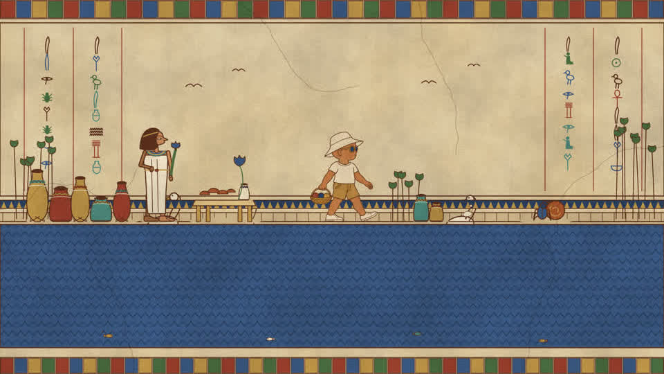
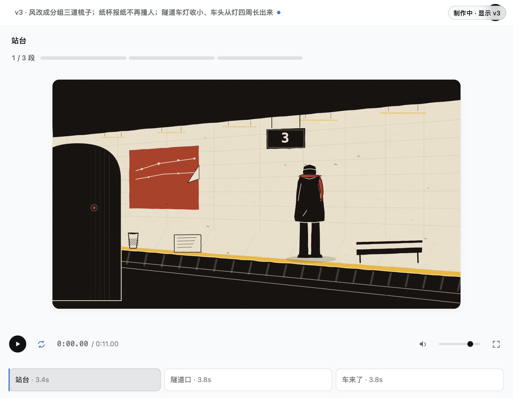
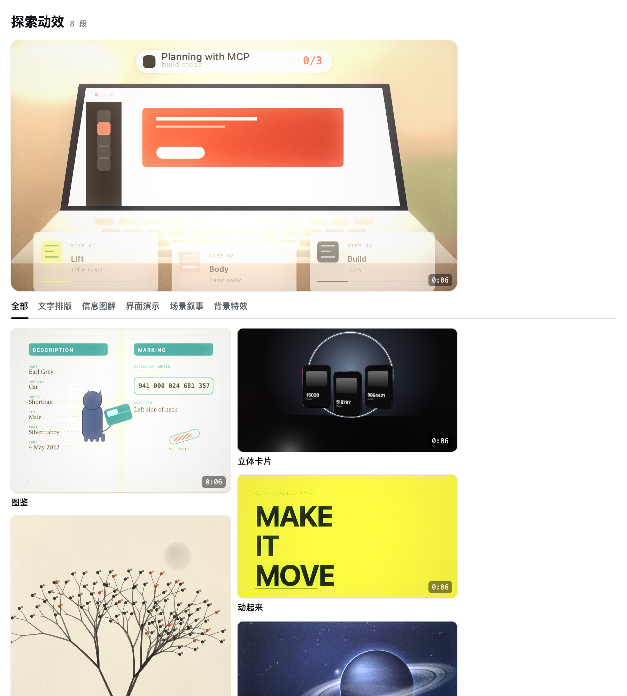

# dsh-motion

**一句话，一条片子。** 你描述一个镜头，Agent 把它写成代码，你拿到一条逐帧可复现的 MP4——
同一条片子渲一百次，每一帧都一样。



<sub>Agent 照一句话题目做出来的片子：8 秒，1920×1080，带音轨。
对照的那一帧在 [`examples/egypt/out/ref/target.png`](examples/egypt/out/ref/target.png)。</sub>

---

## 为什么不用剪辑软件

剪辑软件给你时间轴，但每一帧都要人摆。这里反过来：

- **片子是代码**。一个场景 = 一个文件，`render(t)` 是时间的纯函数。改一版等于改一次代码，
  可 diff、可回滚、可复用。
- **不是"AI 生成的视频"**。没有模型在猜下一帧——画面是画出来的，所以文字不会糊、数字是真的、
  重渲一百次一个像素都不差。
- **风格不由引擎规定**。引擎里没有一行画画的代码；画法写在片子里，或者从 `kit`、`cards` 抄。

## 装

```bash
dsh plugin --profile web add @vlln/dsh-motion   # 作为 dsh 插件
npx @vlln/dsh-motion init                       # 或者只当命令行用
```

运行时只依赖 Playwright（用本机已有的 Chrome for Testing，不额外下浏览器）。

## 三步做出第一条

```bash
mkdir my-film && cd my-film
dsh-motion init          # 时间轴 + 镜头表 + 可删的样例手艺
# 写 motion/镜头表.md：一句话画风、3–6 个色值、每镜一个具体的物和它的动作
# 写 motion/scenes/<id>.mjs：mount(ctx) 一次画好静的，render(t) 每帧画动的
dsh-motion check --deliver out/film.mp4
```

`check --deliver` 只断言**事实**：有画面、有声音、长度对得上、不是静止、不是一片蓝紫雾。
像不像、好不好看，它不判——那是并排图和人的事。

## 面板

在 dsh 里打开，右边是参数和批注，右上角标着这次显示的是哪个版本：



改一个参数、点一下画面上的字、写一句批注，落到 `timeline.json` 和场景代码里——
Agent 下一步看到的就是你改过的样子。

空工作区打开是画廊，七格能播的样板，点开看做法，也可以直接丢给 Agent 复刻：



## 它现在能做成什么样

诚实地说：**结构像样，细节还粗。**

| | 盲评 | 是什么 |
|---|---|---|
| 埃及墓室壁画 | 64 | 上图的片子。卡在媒介质感与密度，不在骨架 |
| 地铁进站的一阵风 | 55 | 麻胶版三色套印，独立 Agent 自写画法 |
| 一杯茶凉掉的过程 | 51 | 双版木口木刻 |
| 一枚硬币转到停下 | 37 | 铜版画排线 |

三次冷启动都是**一个没参与过本仓库的 Agent**，拿到一句话题目和说明书，从 `init` 开始做的。
它们都交付了带音轨的成片、都过了交付门禁、**没有一次向引擎要过画法**。

它做不到的：实拍、3D、浅景深、真实高光。它是图形与排版的工具，不是摄影机。

## 里面有什么

```
src/       引擎：时间、画布、确定性、缓存、编码、音频、字体、素材。没有一行画画的代码
kit/       可整删的样例手艺，init 时复制进你的片子
cards/     一个风格一张卡：管线、色板、签名特征、坑、短板
howto/     做法的规程：新风格六步、从参考里取、角色、镜头表、审片、交付
showcase/  给用户看的样板（画廊）。引擎不引用它
```

判据三条：**`src/` 里没有画法；`kit/` 删掉照样跑；`cards/` 加一张，引擎不加一行。**

想深入：[功能细节](docs/features.md) · [契约](docs/kernel-contract.md) · [为什么这么设计](docs/decisions.md) ·
[门禁清单](docs/gates.md) · [已知限制](docs/limits.md) · [给 Agent 的说明书](skills/dsh-motion/SKILL.md)

## 来源与致谢

这套东西不是凭空设计的。它来自把
**[alchaincyf/huashu-art-motion](https://github.com/alchaincyf/huashu-art-motion/tree/main)**
（花叔 · 花生，MIT）读一遍、再推倒重做一遍。

**从那里取的**（都是做法，不是代码）：

- **六步做一种新风格**，以及「先钉死对照物再动手」这条纪律；
- **「人用 AI 生帧，代码负责合成」**——角色通道直接来自它的窄桥；
- **壁画的表面做法**：墙是现画的 fBm 纹理，表面是一整幅 multiply 层，发丝裂纹画进同一层，
  所以会跨过人物。照抄之后媒介分 7→9，单帧 10.1ms→0.18ms（[`howto/从参考里取.md`](howto/从参考里取.md)）；
- **空工作区给画廊**，不给一段说明。

**分界**：它的引擎里带着画法（`brush`/`medium`/`finish`），这里一行都没有；风格知识拆成
`kit` / `cards` / `howto` / `showcase`，引擎永不 import 其中任何一个。

## 许可

MIT
